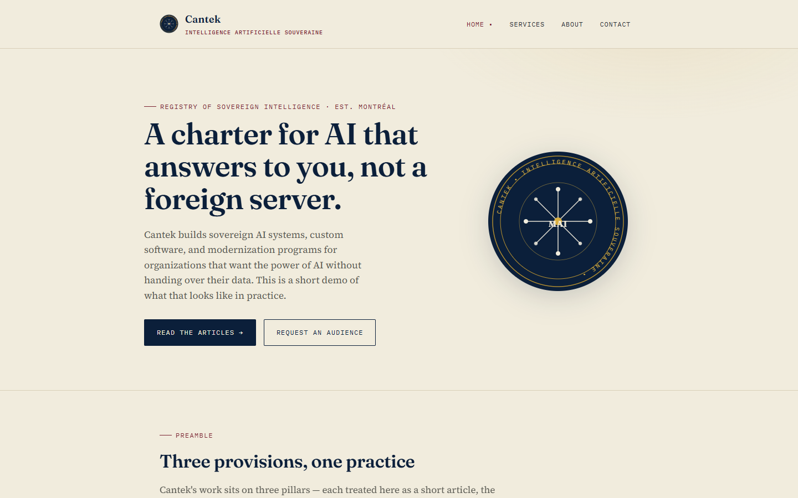
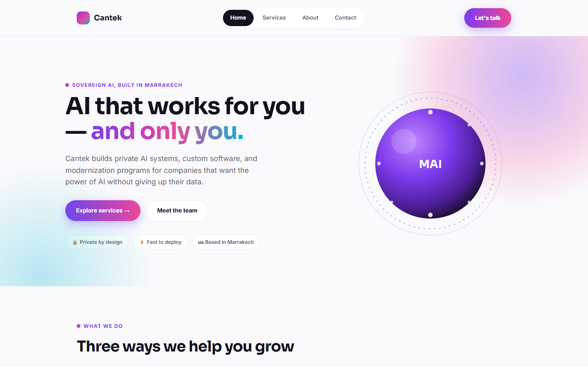

# Cantek – Showcase Website Concepts

Two landing-page concepts I designed and built for **Cantek**, a software and AI studio based in Montréal and Marrakech. I made them during my internship at **CANADA SOFT / Cantek** (July–September 2025). They are published here with the company's permission.

Both concepts present the same content (services, leadership and contact) in two very different visual directions.

## Live demo

- **Showcase home:** https://ilias-lamtaouab.github.io/cantek-showcase/
- **Charter of Digital Sovereignty:** https://ilias-lamtaouab.github.io/cantek-showcase/cantek-sovereign.html
- **AI That Answers Only To You:** https://ilias-lamtaouab.github.io/cantek-showcase/cantek-saas.html

## Screenshots

### Charter of Digital Sovereignty


### AI That Answers Only To You


## The two concepts

### 1. Charter of Digital Sovereignty (`cantek-sovereign.html`)

An editorial design inspired by official documents and charters.

- Navy, gold and parchment palette with Fraunces and Source Serif 4 serif typography, plus IBM Plex Mono for labels
- Content written as "articles" and "provisions", like a formal charter
- Inline SVG seal reused across the page through an HTML `<template>`, with an entrance animation

### 2. AI That Answers Only To You (`cantek-saas.html`)

A modern SaaS-style design.

- Violet, fuchsia and cyan palette with Sora and Inter typography
- Gradient headline text and soft blurred colour glows
- Inline SVG "MAI" orb reused across the page through an HTML `<template>`
- Sticky header with a frosted-glass (backdrop blur) effect

### Shared features

- **Four pages in one file** (Home, Services, About, Contact), switched with hash-based navigation (`#home`, `#services`, …) that works with the browser back and forward buttons
- **Scroll-reveal animations** using `IntersectionObserver`, with a fallback for older browsers
- **Contact form with front-end feedback**: built-in HTML validation, and on submit the button confirms the message, disables itself, then resets the form. It's a demo and doesn't send data anywhere.
- **Responsive layout**: grids collapse to a single column on tablets and phones
- **Accessibility**: respects `prefers-reduced-motion` and uses labelled form fields
- **No build step and no dependencies**: each page is a single self-contained HTML file

## Tech used

- HTML5
- CSS3 (custom properties, Grid, Flexbox, media queries, animations)
- Vanilla JavaScript
- Google Fonts

## Run locally

No installation needed. Open `index.html` in a browser, or serve the folder:

```bash
python -m http.server 8000
```

Then go to http://localhost:8000.

## Author

**Mohamed Ilias Lamtaouab**
